 

 

## About

AI/ML Engineer with hands-on experience across **machine learning, NLP and generative AI**. I take models from data preprocessing and feature engineering through training, tuning and evaluation, and I build conversational AI that makes those models useful to non-technical users.

My current focus is **speech AI and bilingual (Urdu / English) NLP** on fully self-hosted model stacks, plus **RAG-based assistants** built with LangChain, LangGraph and LLMs such as Gemini and OpenAI.

 

## At a Glance

| 3 | 2 | 82% | 100% |
|:-:|:-:|:-:|:-:|
| AI/ML internships | Languages in NLP work (Urdu · English) | Accuracy on the student-performance model | Self-hosted stack behind FluentWay |

 

## What I Do

<table>
<tr>
<td width="33%" valign="top">

### 🧠 Machine Learning
Supervised and unsupervised models: regression, classification and ensembles, validated with cross-validation and **Precision, Recall, F1, ROC-AUC and RMSE**.

</td>
<td width="33%" valign="top">

### 💬 Conversational AI
**RAG assistants** and agents with LangChain and LangGraph, plus models wrapped in chatbots that explain results in plain language.

</td>
<td width="33%" valign="top">

### 🎙️ Speech & Bilingual NLP
Speech analysis and coaching in **Urdu and English**, running on self-hosted models so user data stays private.

</td>
</tr>
</table>

 

## Selected Work

| Project | Problem | Approach | Stack |
|:--|:--|:--|:--|
| **FluentWay** *Bilingual AI speech coach (ongoing)* | Learners need personalised feedback on spoken fluency in Urdu and English | Listens, analyses speech and adapts coaching over time, on a fully self-hosted model stack independent of third-party APIs | `Python` `Speech AI` `LLMs` `NLP` |
| **Educational Institute Chatbot** *RAG pipeline* | Students and staff struggle to find answers across FAQs and academic records | Context-aware RAG assistant over institutional data, served through an interactive Streamlit interface | `LangChain` `LangGraph` `Gemini` `Streamlit` |
| [**Customer Churn Chatbot**](https://github.com/ZohaAsghar/Customer-Churn) *ML + conversational AI* | Business users can't act on raw churn scores | Classifier with engineered features, evaluated on Precision / Recall / F1, exposed through a chatbot that explains risk in plain language | `Scikit-Learn` `LangChain` `Python` |
| **Product Sales Analysis** *Exploratory data analysis* | Seasonal patterns and revenue drivers hidden in large sales data | End-to-end EDA on Kaggle datasets with clear visual storytelling | `Pandas` `NumPy` `Seaborn` `Matplotlib` |

<b>More repositories</b>

 

| Repository | Summary |
|:--|:--|
| [House-price-prediction](https://github.com/ZohaAsghar/House-price-prediction) | Regression model forecasting property values from location and size |
| [Student-Performance](https://github.com/ZohaAsghar/Student-Performance) | Predicts student outcomes with 82% accuracy to enable early intervention |
| [Fraud-detection](https://github.com/ZohaAsghar/Fraud-detection) | Classification model for flagging fraudulent transactions |
| [taitanic-prdiction](https://github.com/ZohaAsghar/taitanic-prdiction) | Survival prediction: EDA, feature engineering, modeling |
| [Ai-Impact-in-future-on-jobs-market-in-2030](https://github.com/ZohaAsghar/Ai-Impact-in-future-on-jobs-market-in-2030) | Data-driven look at how AI may reshape the job market |

 

## Experience

| Period | Role | Organisation | Highlights |
|:--|:--|:--|:--|
| **Aug 2026 – Present** | AI/ML Intern (Remote) | Hexovate Solutions | Building and evaluating Scikit-Learn and TensorFlow models in a remote team workflow; iterating on Precision, Recall and F1 |
| **Jun 2026 – Aug 2026** | ML Engineer, Model Training (Onsite Intern) | Tech Solutions | Full training lifecycle: tuning, cross-validation, overfitting mitigation; evaluated with ROC-AUC and RMSE |
| **Jan 2025 – Jun 2025** | AI/ML Intern | Intellix Soft | Six months of model building, data cleaning, EDA and evaluation on real project data |

 

## Technical Toolkit

| Area | Tools |
|:--|:--|
| **Generative AI & Agents** | RAG · AI Agents · LangChain · LangGraph · Gemini · OpenAI · Prompt Engineering · Voice AI (VAPI) · Self-Hosted Models |
| **Machine Learning** | Supervised & Unsupervised Learning · Classification · Regression · Ensembles · Deep Learning · Hyperparameter Tuning · Cross-Validation · Churn Prediction |
| **NLP & Speech** | Bilingual (Urdu / English) NLP · Speech AI · Conversational AI architecture |
| **Data & Engineering** | Python · TensorFlow · Scikit-Learn · Pandas · NumPy · Seaborn · Matplotlib · Streamlit · API integration · ML pipelines |

 

## Education

**BS Information Technology**, University of Bahawalpur · 2022 – 2026

 

## GitHub Activity

<picture>
  <source media="(prefers-color-scheme: dark)" srcset="https://github-readme-stats.vercel.app/api?username=ZohaAsghar&show_icons=true&theme=transparent&hide_border=true&title_color=38bdf8&icon_color=818cf8&text_color=e2e8f0&count_private=true"/>
  
</picture>
<picture>
  <source media="(prefers-color-scheme: dark)" srcset="https://github-readme-stats.vercel.app/api/top-langs/?username=ZohaAsghar&layout=compact&theme=transparent&hide_border=true&title_color=38bdf8&text_color=e2e8f0"/>
  
</picture>

 

## Let's Work Together

I'm looking for **AI/ML engineering roles and collaborations** where I can build practical, production-minded intelligent systems.

📧 [zohaasghar084@gmail.com](mailto:zohaasghar084@gmail.com) &nbsp;·&nbsp; 💼 [linkedin.com/in/zoha-asghar-](https://linkedin.com/in/zoha-asghar-)

 

Built with Python, curiosity and a lot of cross-validation.

