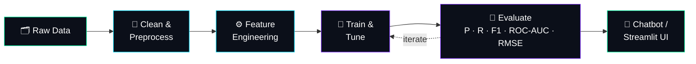

<div align="center">


[](https://linkedin.com/in/zoha-asghar-)
[](mailto:zohaasghar084@gmail.com)


</div>

<br/>

## `~/whoami`

```bash
$ whoami
zoha_asghar

$ cat profile.json
{
  "role":       "AI/ML Engineer",
  "base":       "Lahore, Pakistan 🇵🇰",
  "education":  "BSIT · University of Bahawalpur (2022 – 2026)",
  "experience": "3 AI/ML internships",
  "superpowers": [
    "RAG-based conversational assistants",
    "Bilingual (Urdu/English) NLP & Speech AI",
    "Churn prediction & classification",
    "Self-hosted, privacy-first model stacks"
  ],
  "status":     "🟢 open to roles, collabs & great ideas"
}
```

<br/>

## `~/pipeline`  ·  how I build



<br/>

## `~/projects`

<table>
<tr>
<td width="50%" valign="top">

### 🎙️ FluentWay
**Bilingual AI Speech Coach** · *ongoing*

Listens to the learner in **Urdu & English**, analyses their speech and adapts coaching over time. Runs on a **fully self-hosted model stack**, so learner data stays private and independent of third-party APIs.

`Speech AI` `LLMs` `NLP` `Self-Hosted`

</td>
<td width="50%" valign="top">

### 🎓 Institute Chatbot
**RAG Pipeline**

Context-aware assistant that answers questions from institutional FAQs and academic databases, served through an interactive **Streamlit** app for students and staff.

`RAG` `LangChain` `LangGraph` `Gemini` `Streamlit`

</td>
</tr>
<tr>
<td width="50%" valign="top">

### 📞 [Churn Prediction Chatbot](https://github.com/ZohaAsghar/Customer-Churn)
**ML + Conversational AI**

Classification model with engineered features that spots customers at risk of leaving, wrapped in a chatbot that explains the risk in **plain language** for business users.

`Scikit-Learn` `LangChain` `F1 · Precision · Recall`

</td>
<td width="50%" valign="top">

### 📊 Product Sales Analysis
**EDA on Kaggle data**

End-to-end exploration of large sales datasets to uncover **seasonal purchase trends** and key **revenue drivers**.

`Pandas` `NumPy` `Seaborn` `Matplotlib`

</td>
</tr>
</table>

<details>
<summary><b>🧪 More experiments in the lab (click to expand)</b></summary>
<br/>

| Repo | What it does |
|:--|:--|
| 🏠 [House-price-prediction](https://github.com/ZohaAsghar/House-price-prediction) | Forecasts property values from location, size & more |
| 🎓 [Student-Performance](https://github.com/ZohaAsghar/Student-Performance) | Predicts student outcomes with **82% accuracy** to flag at-risk students early |
| 💳 [Fraud-detection](https://github.com/ZohaAsghar/Fraud-detection) | Flags fraudulent transactions |
| 🚢 [taitanic-prdiction](https://github.com/ZohaAsghar/taitanic-prdiction) | Survival prediction: EDA → features → model |
| 🤖 [AI impact on jobs 2030](https://github.com/ZohaAsghar/Ai-Impact-in-future-on-jobs-market-in-2030) | How AI may reshape the job market |

</details>

<br/>

## `~/experience`

```text
 2026 ──────────────────────────────────────────────────────────────▶ now
   │
   ├─ Aug 2026 ▸ NOW    AI/ML Intern (Remote)            Hexovate Solutions
   │                    └ Scikit-Learn & TensorFlow models, EDA, P/R/F1 tuning
   │
   ├─ Jun 2026 ▸ Aug    ML Engineer, Model Training      Tech Solutions
   │                    └ Hyperparameter tuning, cross-validation, ROC-AUC & RMSE
   │
 2025
   └─ Jan 2025 ▸ Jun    AI/ML Intern                     Intellix Soft
                        └ 6 months · data prep → model implementation
```

<br/>

## `~/skills`

<table>
<tr>
<td valign="top" width="33%">

**🤖 Generative AI**
- RAG
- AI Agents
- LangChain · LangGraph
- Gemini · OpenAI
- Prompt Engineering
- Voice AI (VAPI)
- Self-Hosted Models

</td>
<td valign="top" width="33%">

**🧠 Machine Learning**
- Supervised & Unsupervised
- Classification · Regression
- Ensemble Methods
- Deep Learning
- Cross-Validation
- Hyperparameter Tuning
- Churn Prediction

</td>
<td valign="top" width="33%">

**🛠️ Data & Engineering**
- Python
- TensorFlow · Scikit-Learn
- Pandas · NumPy
- Seaborn · Matplotlib
- Streamlit · API Integration
- HTML5 · CSS
- Bilingual NLP · Speech AI

</td>
</tr>
</table>

<br/>

## `~/stats`

<div align="center">


</div>

<br/>

## `~/contact`

```python
if you_have("an AI/ML problem worth solving"):
    reach_out(
        linkedin="linkedin.com/in/zoha-asghar-",
        email="zohaasghar084@gmail.com",
    )
    # let's build something intelligent 🚀
```


